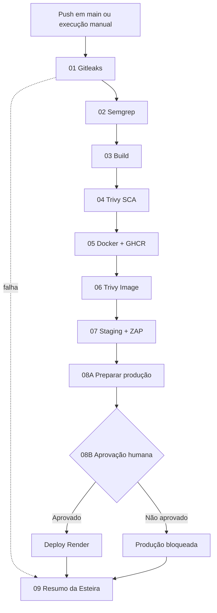
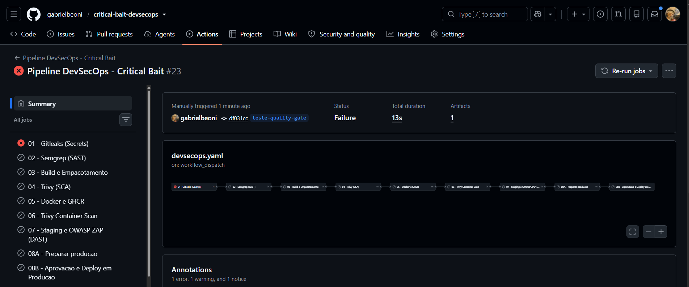
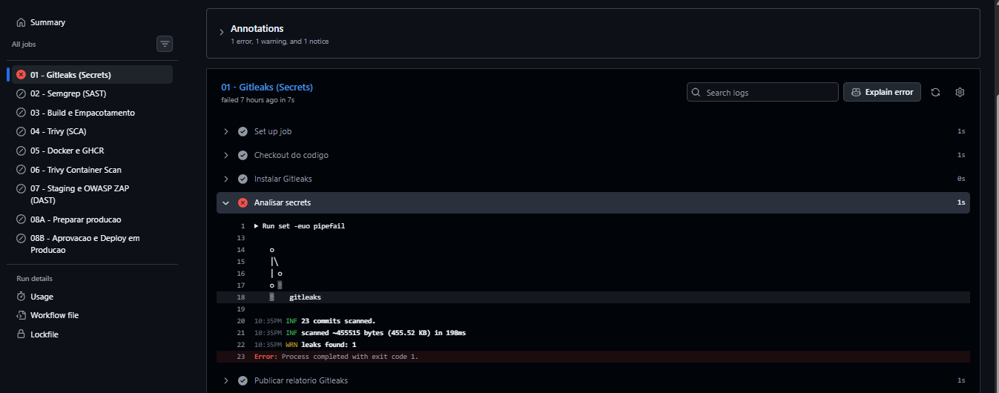
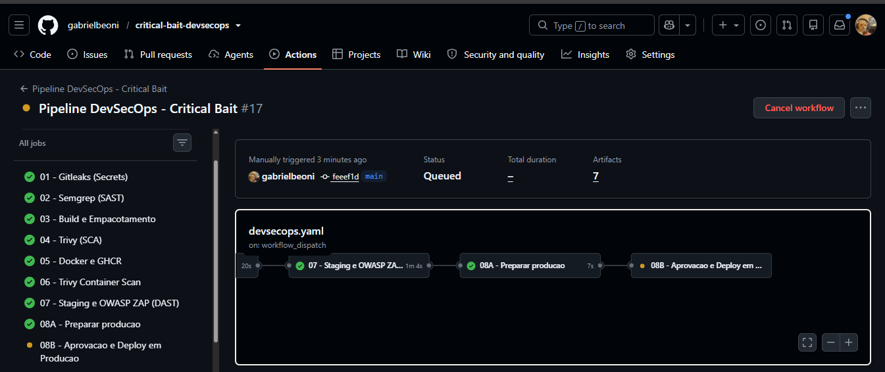
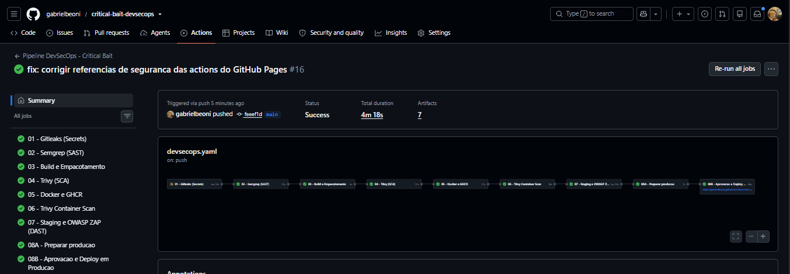

# Critical Bait — Esteira DevSecOps CI/CD | FIAP CP03

[](https://github.com/gabrielbeoni/critical-bait-devsecops/actions)

**Workflow principal:** `.github/workflows/devsecops.yml` (execução #15). O workflow `.yaml` usado no teste #23 foi desativado; as execuções não devem ser tratadas como a mesma configuração.

## Projeto e equipe

O **Critical Bait** é uma aplicação web gamificada de conscientização em cibersegurança, com exercícios sobre phishing e engenharia social. O CP03 da disciplina **DevSecOps — FIAP (2026)** implementa uma esteira automatizada de validação, análise de segurança, publicação de contêiner e deploy com aprovação humana.

| RM | Integrante |
|---|---|
| 561961 | Gabriel Beoni Sanches Sammartino |
| 563302 | Enzo Marques Mizuguchi |
| 561794 | Victor Nicolas Silva Pereira |
| 562610 | Clara Espanha Alves |

**Links:** [Repositório](https://github.com/gabrielbeoni/critical-bait-devsecops) · [Execuções GitHub Actions](https://github.com/gabrielbeoni/critical-bait-devsecops/actions) · [Produção Render](https://critical-bait-ghcr.onrender.com) · [GitHub Pages](https://gabrielbeoni.github.io/critical-bait-devsecops/) · [Imagem GHCR](https://github.com/gabrielbeoni/critical-bait-devsecops/pkgs/container/critical-bait-devsecops)

## Arquitetura da pipeline



A atividade reúne **oito categorias funcionais**; a implementação evidencia as subdivisões **08A e 08B** e um job adicional de resumo. As dependências entre jobs impedem avanço quando um controle bloqueante falha. O resumo é projetado para executar mesmo em falhas (`always()`). Veja [documentação detalhada](docs/pipeline.md).

## Etapas e relatórios

| Etapa | Ferramenta / controle | Objetivo | Artefato da execução #15 |
|---|---|---|---|
| 01 | Gitleaks | Detectar segredos no repositório; bloqueante | `relatorio-01-gitleaks` |
| 02 | Semgrep (SAST) | Detectar padrões inseguros no código; bloqueante | `relatorio-02-semgrep` |
| 03 | Build | Validar e empacotar a aplicação | `relatorio-03-build` e `artefato-aplicacao` |
| 04 | Trivy filesystem (SCA) | Inspecionar dependências e configuração; HIGH/CRITICAL bloqueantes | `relatorio-04-trivy-sca` |
| 05 | Docker + GHCR | Construir e publicar imagem rastreável | `relatorio-05-docker-build` |
| 06 | Trivy image | Inspecionar a imagem; HIGH/CRITICAL bloqueantes | `relatorio-06-trivy-image` |
| 07 | Staging + OWASP ZAP | Análise dinâmica baseline, de caráter informativo | `relatorio-07-homologacao-zap` |
| 08A | Preparar produção | Preparar metadados e publicação | `relatorio-08-producao` |
| 08B | Aprovação e deploy | Aprovação manual do environment `producao` e deploy no Render | `relatorio-08-producao` |
| 09 | Resumo da Esteira | Consolidar status e achados, inclusive em falhas | `resumo-da-esteira` |

**Acesso aos relatórios:** [abrir a execução #15 no GitHub Actions](https://github.com/gabrielbeoni/critical-bait-devsecops/actions) e baixar cada artifact pelo nome indicado na tabela (os links individuais dependem do identificador da execução e da retenção do GitHub). Sua disponibilidade depende do prazo de retenção do GitHub. As evidências visuais fornecidas estão em [`docs/evidencias/`](docs/evidencias/).

## Execuções de referência

| Campo | Execução bem-sucedida | Teste do quality gate |
|---|---|---|
| Número | **#15** | **#23** |
| Branch | `main` | `teste-quality-gate` |
| Resultado | `success` | `failure` |
| Observação | Todos os jobs concluídos, com **11 artefatos** | Gitleaks falhou e jobs posteriores foram ignorados |

**Commit da execução #15:** `626d0a2b6bc5c75df4a87457ae7c712256314219`.

**Evidência do bloqueio:** na execução #23 (workflow `.yaml`, atualmente desativado), a etapa `Analisar secrets` do Gitleaks registrou `23 commits scanned`, `leaks found: 1` e `exit code 1`. Isso comprova a detecção de uma possível credencial e o bloqueio **naquele workflow**, mas não revela a regra ou o valor detectado e não demonstra, isoladamente, comportamento idêntico no `.yml` principal. Não divulgar segredos reais.





## Indicadores de segurança — execução #15

| Controle | Resultado observado |
|---|---|
| Gitleaks | 0 segredos reportados |
| Semgrep | 0 achados e 0 erros |
| Trivy SCA | 0 HIGH/CRITICAL; TXT apresenta 1 LOW relacionado à ausência de `HEALTHCHECK` (`DS-0026`) |
| Trivy Container | 0 HIGH/CRITICAL no resumo; TXT lista 2 UNKNOWN e 1 MEDIUM (`musl`, `musl-utils`, `zlib`) |
| OWASP ZAP Baseline | 66 PASS, 0 FAIL e 2 tipos de alertas informativos; sem alertas HIGH/MEDIUM/LOW |

**Leitura crítica:** os formatos TXT e JSON de alguns relatórios não coincidem integralmente; a diferença é registrada em [observações](docs/observacoes.md). A execução aprovada não significa ausência absoluta de vulnerabilidades.

## Como executar localmente

A aplicação é um frontend estático (HTML, CSS e JavaScript). No diretório do projeto:

```bash
git clone https://github.com/gabrielbeoni/critical-bait-devsecops.git
cd critical-bait-devsecops
python -m http.server 8000
```

Acessar `http://localhost:8000`. É necessário ter Python 3 instalado; alternativamente, pode-se usar um servidor estático do editor.

## Como executar via Docker

```bash
docker build -t critical-bait:local .
docker run --rm -p 8080:8080 critical-bait:local
```

Acessar `http://localhost:8080`. A configuração do contêiner usa Nginx não privilegiado e porta **8080**. Para consumir uma imagem publicada no GHCR, conferir a tag ou o digest correspondente à execução desejada antes do `docker pull`.

## Aprovação manual e produção

A produção é controlada pelo GitHub Environment `producao`, com revisão humana antes do deploy no **Render**. O fluxo relaciona o commit validado, a imagem publicada e a aprovação do deploy. O histórico da execução #15 e as capturas em `docs/evidencias/` documentam o processo, incluindo a aprovação manual, a publicação no Render e o status **Live** registrado nas evidências. O status Live na captura é uma evidência do momento do registro, não uma garantia de disponibilidade contínua.

| Registro | Informação |
|---|---|
| Environment | `producao` |
| Decisão | Aprovação manual necessária antes do deploy |
| Execução de referência | #15 (`main`) |
| Critérios de revisão | Gitleaks, Semgrep, Trivy SCA, Trivy Container, ZAP e integridade do build |
| Aprovador e horário exatos | Não transcritos nesta documentação; consultar o registro de aprovação da execução #15 no GitHub |
| Produção | https://critical-bait-ghcr.onrender.com |

### Evidências de aprovação e produção





A execução #15 também disponibilizou o artifact `resumo-da-esteira`. O print do Summary deve ser incorporado ao README quando o arquivo correspondente estiver identificado entre as capturas; não foi substituído por uma imagem de outra etapa.

## Evidências e documentação

- [Pipeline: etapas, bloqueios, artifacts e rastreabilidade](docs/pipeline.md)
- [Observações técnicas, achados, limitações e lições aprendidas](docs/observacoes.md)
- [Capturas de tela da execução](docs/evidencias/)
- [Relatório Executivo](docs/Relatorio_Executivo_CP03_Critical_Bait.pdf).

**Limitação de escopo:** a plataforma é um protótipo acadêmico. Recursos de autenticação e persistência implementados exclusivamente no navegador não equivalem a um serviço corporativo com backend e controle de acesso centralizado.
