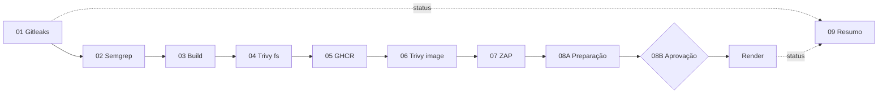

# Documentação da Esteira DevSecOps — Critical Bait

## 1. Objetivo e escopo

A esteira do CP03 aplica **shift-left security** à aplicação Critical Bait, exigindo validações antes de publicar a imagem e de promover a versão a produção. Implementada no GitHub Actions, utiliza GitHub Container Registry (GHCR), GitHub Environments e Render.

**Referência verificável:** execução **#15** em `main`, commit `626d0a2b6bc5c75df4a87457ae7c712256314219`; execução **#23** em `teste-quality-gate` para demonstrar interrupção automática.

## 2. Fluxo de dependências

A aprovação humana ocorre **após** as análises e **antes** do deploy. O ZAP Baseline é informativo; os demais quality gates bloqueantes interrompem o fluxo conforme a condição de erro configurada. O job de resumo deve usar `if: always()` para registrar sucesso ou falha das etapas.

## 3. Etapas, critérios e artefatos

| Etapa | Ferramenta / controle | Objetivo | Artefato da execução #15 |
|---|---|---|---|
| 01 | Gitleaks | Detectar segredos no repositório; bloqueante | `relatorio-01-gitleaks` |
| 02 | Semgrep (SAST) | Detectar padrões inseguros no código; bloqueante | `relatorio-02-semgrep` |
| 03 | Build | Validar e empacotar a aplicação | `relatorio-03-build` e `artefato-aplicacao` |
| 04 | Trivy filesystem (SCA) | Inspecionar dependências e configuração; HIGH/CRITICAL bloqueantes | `relatorio-04-trivy-sca` |
| 05 | Docker + GHCR | Construir e publicar imagem rastreável | `relatorio-05-docker-build` |
| 06 | Trivy image | Inspecionar a imagem; HIGH/CRITICAL bloqueantes | `relatorio-06-trivy-image` |
| 07 | Staging + OWASP ZAP | Análise dinâmica baseline, de caráter informativo | `relatorio-07-homologacao-zap` |
| 08A | Preparar produção | Preparar metadados e publicação | `relatorio-08-producao` |
| 08B | Aprovação e deploy | Aprovação manual do environment `producao` e deploy no Render | `relatorio-08-producao` |
| 09 | Resumo da Esteira | Consolidar status e achados, inclusive em falhas | `resumo-da-esteira` |

### 01 — Gitleaks

Analisa segredos potencialmente versionados. Um resultado de falha bloqueia os jobs dependentes. Na execução #15, o relatório indicou **0 segredos**. Na execução #23, realizada com um workflow `.yaml` posteriormente desativado, o log da etapa `Analisar secrets` registra `23 commits scanned`, `leaks found: 1` e `exit code 1`; os jobs dependentes não prosseguiram. O log não expõe o tipo ou valor do segredo. A execução principal #15 utilizou `.yml`, de modo que as duas execuções não demonstram necessariamente configuração idêntica.

### 02 — Semgrep (SAST)

Analisa padrões de código potencialmente inseguros. O resultado da #15 registra **0 achados e 0 erros**. É uma análise estática, não um substituto para testes dinâmicos.

### 03 — Build e empacotamento

Valida a estrutura da aplicação estática e prepara os arquivos distribuíveis, gerando artefatos para etapas seguintes. Um erro de build impede publicação.

### 04 — Trivy SCA (filesystem)

Analisa dependências e configurações do repositório. O gate considera **HIGH/CRITICAL**. Na #15 não foram reportados achados nessas severidades; o relatório TXT apontou **DS-0026 (LOW)**, referente a `HEALTHCHECK` ausente no Dockerfile. O TXT registra 27 testes (26 aprovados, 1 LOW), enquanto o JSON consultado lista 20 checks sem falhas; é necessária atenção ao escopo e formato de saída.

### 05 — Docker e GHCR

Constrói e publica imagem no `ghcr.io/gabrielbeoni/critical-bait-devsecops`. A aplicação é servida em Nginx não privilegiado na porta **8080**. Para auditoria, a tag associada ao SHA e, idealmente, o digest devem ser conferidos no log de publicação.

### 06 — Trivy Container Scan

Inspeciona a imagem de contêiner. O resumo da #15 indica **0 HIGH/CRITICAL**, porém o TXT registra **1 MEDIUM e 2 UNKNOWN** envolvendo `musl`, `musl-utils` e `zlib`; a representação no JSON não coincide integralmente. Os achados remanescentes precisam de acompanhamento.

### 07 — Homologação e OWASP ZAP

Inicia a aplicação em staging e realiza varredura baseline contra o ambiente autorizado. Resultado da #15: **66 PASS, 0 FAIL** e dois tipos de alertas informativos (`Modern Web Application` e `Non-Storable Content`), sem alertas HIGH/MEDIUM/LOW. O resultado é informativo para o aprovador.

### 08A e 08B — Preparação, aprovação e produção

Prepara a promoção da imagem e aguarda revisão humana no GitHub Environment `producao`. Após aprovação, realiza deploy no **Render**. As capturas de aprovação manual, deploy Render e status Live já foram coletadas em `docs/evidencias/`. Identidade e horário do aprovador não são transcritos sem consulta ao registro original do deployment.

### 09 — Resumo da Esteira

Consolida o status das etapas e publica `resumo-da-esteira`. O objetivo é manter visibilidade mesmo quando a execução é bloqueada. A #15 disponibilizou **11 artifacts**, abrangendo os relatórios das verificações, o build, a produção e o resumo.

## 4. Quality gates e cenário de bloqueio

| Situação | Comportamento esperado | Evidência disponível |
|---|---|---|
| Secrets detectados ou erro no Gitleaks | Interromper cadeia dependente | Execução #23 (`.yaml` desativado): `leaks found: 1`, `exit code 1`, jobs posteriores `skipped` |
| Falha no Semgrep | Interromper cadeia | Configuração da esteira; não há teste de falha independente documentado |
| HIGH/CRITICAL no Trivy | Interromper cadeia | Critério documentado; #15 sem achados nessas severidades |
| Alertas informativos do ZAP | Registrar e encaminhar à aprovação | #15: alertas informativos sem falha |
| Produção sem aprovação | Não realizar deploy | Gate manual `producao` |

O log da #23 comprova uma detecção pelo Gitleaks e a interrupção do workflow `.yaml` desativado, mas **não identifica a natureza do segredo** nem valida diretamente o workflow `.yml` principal. Evidências: `docs/evidencias/12-quality-gate-bloqueado.png` e `docs/evidencias/14-gitleaks-run23-log.png`.

## 5. Rastreabilidade

| Elemento | Referência |
|---|---|
| Repositório | https://github.com/gabrielbeoni/critical-bait-devsecops |
| Branch de referência | `main` |
| Commit de referência | `626d0a2b6bc5c75df4a87457ae7c712256314219` |
| Execução de sucesso | #15 |
| Execução bloqueada | #23, `teste-quality-gate` |
| Registry | `ghcr.io/gabrielbeoni/critical-bait-devsecops` |
| Environment | `producao` |
| Produção | https://critical-bait-ghcr.onrender.com |

**Escopo das evidências:** a aprovação, o deploy Render e o status Live estão registrados em capturas. O digest imutável e a identificação exata do aprovador não são reproduzidos aqui sem transcrição do registro original.

## 6. Como consultar relatórios

1. Abrir [GitHub Actions](https://github.com/gabrielbeoni/critical-bait-devsecops/actions).
2. Selecionar a execução **#15** e consultar o grafo de jobs.
3. Baixar os **Artifacts** no rodapé da execução; consultar também a aba **Summary**.
4. Para o bloqueio, consultar a execução **#23**, seu log de Gitleaks e o status dos jobs dependentes.
5. Consultar `docs/evidencias/` para as capturas incluídas na entrega.

A retenção de artifacts é limitada pela configuração do repositório; os arquivos podem expirar.

## 7. Segurança operacional

Credenciais de publicação devem permanecer em **GitHub Secrets / Environment Secrets**. O contêiner deve operar com usuário não privilegiado. O ZAP deve testar somente a aplicação autorizada. Para promover versões, verificar a correspondência entre **commit, tag/digest, execução, aprovação e deployment**.
